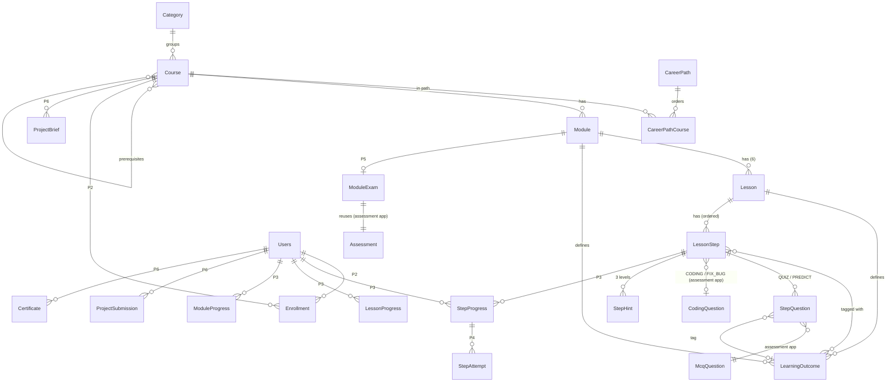

# BashaByte Courses: Architecture (Phase 0)

_Status: **approved 2026-11-07** (D1–D7 as recommended). Phase 1 built; see `CHANGELOG.md`. Written 2026-11-07 from the code on `main`. Where this document and `MASTER_PROMPT.md` disagree, the code wins (prompt §2), and each difference is listed in §1._

---

## 1. What exists today (and where the prompt differs)

| Area | What the code has | Effect on Courses |
|---|---|---|
| `courses` app | **Not empty.** One legacy model, `courses.Courses` (title, description, duration, is_paid, price, rating, thumbnail/intro_video/attachment files), 2 migrations, 6 seeded rows, a bare `course_list` view and template. **Not routed** (no `courses/` in `leetcode_project/urls.py`). | Replace it with the new model set (see decision **D2**). Nothing else references it. |
| `colleges` app | **Does not exist.** It is only planned (`BASHABYTE_CONTEXT.txt` §17–18). | Courses must not depend on it. Cohort and college features (Phases 7 and 10) are deferred until it exists (decision **D3**). |
| Users and roles | `users.Users`: UUID PK, email login, `role` (user / moderator / admin), `is_staff`, `is_faculty`, `is_premium`. | Permission matrix (§6) uses `is_staff`, `is_faculty` and `is_premium`. |
| Code execution | **Judge0** over HTTP (`submissions/judge0.py`), shared by practice problems **and** assessments. Batch submit plus a single batched status poll per round. Per-problem limits: `Problem.time_limit_seconds` (default 2 s), `memory_limit_mb` (256), language multipliers (Java ×2, JS/Go ×1.5). Output compared with whitespace trimmed (`comparable_case_text`). Background judging via a thread pool (`submissions/queue.py`, `JUDGE_ASYNC`). | PLAYGROUND, FIX_BUG and CODING reuse `submissions.judge` (`run_many`, `judge_limits`, `_summarise`, `is_code_safe`, `_code_reads_input`). There is no second execution path. |
| Practice problems | `problems.Problem` + `TestCase` (sample/hidden, no weights) + `ProblemHint` + `Editorial` + `CodeTemplate` (unused). The editor page has Monaco, Run/Submit, a custom test case and a judge animation. | The editor UI and JS are reusable. Data model: see **D1**. |
| Question bank | `assessment.McqQuestion` / `McqOption` (statement, code_snippet, language, topic/sub_topic, difficulty, a single `explanation`, `allow_multiple`). `assessment.CodingQuestion` (modes **scratch / fix / complete**, starter **and buggy** code per language, **weighted** test cases, its own time and memory limits). | QUIZ and PREDICT use `McqQuestion`. Per-option explanations need one additive field (`McqOption.explanation`, decision **D5**). |
| Assessments | `Assessment → AssessmentSection → AssessmentQuestion` (MCQ or coding) → frozen `AssessmentVersion` snapshots. `Participant → Attempt` (server `expires_at`, `active_session_id`), `AttemptEvent` (incl. `FULLSCREEN_EXIT`), `ViolationLog`, `AssessmentResult`. Faculty and staff manage it. The exam runner UI exists. | Module exams are built **on this** (Phase 5): one `Assessment` per module exam. Random per-attempt draws need an extension (§8). |
| Discussions | `Discussion` has a hard FK to `problems.Problem`; `Comment`; a generic `Vote`. | Lesson discussions (Phase 7) need either a generic target on `Discussion` or a nullable `lesson` FK. Decide in Phase 7. |
| Premium | `SubscriptionPlan`, `Subscription.is_active()`, `PaymentTransaction` (Stripe-shaped), plus `Users.is_premium`. | Gating = `Course.access` (free / premium) checked against an active subscription or `is_premium`. |
| Staff area | `/staff/`, `staff_required = user_passes_test(is_staff)`, CSV/XLSX import via pandas (`staff/services.py`), openpyxl and reportlab exports. | The course builder lives at `/staff/courses/…` and follows these patterns. |
| Libraries | `Markdown`, `bleach` and `Pygments` are installed locally but **not in `requirements.txt`**. reportlab and openpyxl are present. | Add `Markdown`, `bleach` and `Pygments` to `requirements.txt` in Phase 3 (TEXT step). Add `qrcode` in Phase 6. |

---

## 2. Reuse map

| Need | Reuse | New code only for |
|---|---|---|
| Run/grade code | `submissions.judge` + `judge0` client | A thin `courses/grading.py` that maps a step to judge calls and stores `StepAttempt` |
| Editor UI | Monaco setup, theme and judge animation from `problem_detail.js` | Factor shared pieces into `static/js/code_runner.js` (Phase 3) |
| MCQs (QUIZ/PREDICT, exams) | `assessment.McqQuestion` / `McqOption` | Ordered link table `StepQuestion` |
| Coding tasks (CODING/FIX_BUG, exams) | `assessment.CodingQuestion` (**recommended**, D1) | — |
| Module exams | `assessment.Assessment` + runner + `Attempt` + events/violations | `ModuleExam` (blueprint) + per-attempt draw (Phase 5) |
| Staff UI | `/staff/` layout, `staff_required`, import helpers | Builder screens |
| Payments | `premium.Subscription` | Access check helper only |
| Q&A | `discussions` (Phase 7) | Target link |

---

## 3. Planned models (ER diagram)

Phase markers: **P1** content, **P2** catalog/enrollment, **P3–4** progress, **P5** exams, **P6** projects/certificates. Later-phase models are sketched only.

### Phase 1 fields (content)

- **`Category`**: title, slug (unique), order, icon (Bootstrap icon name), description, is_active.
- **`CareerPath`**: title, slug, goal (`placement` / `backend` / `data` / `ai` / `qa` / `devops`), description, order. **`CareerPathCourse`**: path, course, position (unique per path).
- **`Course`**: category FK; title, slug (unique), subtitle, description, level (beginner / intermediate / advanced), version (int, default 1), prerequisites (self M2M, non-symmetrical), est_weeks, access (`free` / `premium`), is_published, published_at, thumbnail (URL field, see §7), capstone_brief (text), created_by, timestamps. Unique key: (slug, version).
- **`Module`**: course FK, position, title, slug, summary, intro_video (provider + id in JSON, see §4), mini_project_brief, is_free_preview. Unique key: (course, position).
- **`Lesson`**: module FK, position, title, slug, est_minutes, is_free_preview. Unique key: (module, position).
- **`LearningOutcome`**: code (unique, e.g. `PY-M3-L2-O1`), text, module FK, lesson FK (nullable: a module-level outcome has no lesson).
- **`LessonStep`**: lesson FK, position, step_type (see §4), title, required (bool), `content` (JSON, validated per type), `coding_question` FK → `assessment.CodingQuestion` (PROTECT, nullable), outcomes (M2M → LearningOutcome), timestamps. Unique key: (lesson, position).
- **`StepQuestion`**: step FK, mcq FK → `assessment.McqQuestion` (PROTECT), position, outcome FK (nullable while drafting, required to publish).
- **`StepHint`**: step FK, level (1–3), text. Unique key: (step, level). (Could live in `content`; kept relational because Phase 4 logs hint usage per level.)

### Phase 2–4 fields (sketch, refined in each phase's plan)

- **`Enrollment`**: user, course, status (active / completed / dropped), started_at, completed_at, last_step FK (for "continue where you left off"). Unique key: (user, course).
- **`StepProgress`**: user, step, status (not_started / in_progress / completed), best_score (0–100), attempts, last_position (JSON: video seconds, scroll, code draft), completed_at. Unique key: (user, step).
- **`StepAttempt`** (append-only): step_progress, submitted_payload (answer ids / Parsons order / code), score, is_correct, judge summary, hints_used, created_at.
- **`LessonProgress`** / **`ModuleProgress`**: cached roll-ups (status, percent, completed_at, unlocked_at, tested_out). They are recomputed by a service on every step completion and are never written from the client.
- **`OutcomeMastery`** (P4): user, outcome, correct, total. Updated from attempts.

---

## 4. Step-type design

### Step types

| Type | Authored payload (`content`) | Relational links | Graded on server? |
|---|---|---|---|
| `VIDEO` | `{provider, video_id, duration_s, chapters:[{t, title}], transcript}` | — | Watched ≥ 80% (player events, checked against duration) |
| `TEXT` | `{markdown, callouts:[{kind: "mistake" / "tip", markdown}]}` | — | Completed on reaching the end |
| `PREDICT` | `{intro}` | `StepQuestion` × n | MCQ scoring |
| `PLAYGROUND` | `{language, starter_code, stdin}` | — | Not graded; completed after one Run |
| `PARSONS` | `{language, lines:[{text, indent}], distractors:[text]}` | — | Order + indent compared on the server |
| `QUIZ` | `{pass_percent: 60}` | `StepQuestion` × n | MCQ scoring; best attempt counts |
| `FIX_BUG` | `{}` (buggy code comes from `CodingQuestionLanguage.buggy_code`) | `coding_question` (mode = fix), `StepHint` | Judge, weighted tests |
| `CODING` | `{}` | `coding_question`, `StepHint` | Judge, weighted tests, partial marks |

### Recommendation: hybrid (typed relations + validated JSON)

**Option A: one model per step type** (VideoStep, TextStep, …, multi-table).
- **For:** database-level types, plain admin forms.
- **Against:** 8+ tables and joins on every lesson load, polymorphic queries are awkward, and every new field needs a migration.

**Option B: one `LessonStep` with a free JSON `content`.**
- **For:** flexible, one query per lesson, easy import/export.
- **Against:** no referential integrity (an MCQ deleted from the bank leaves a dangling id), and no cheap "where is this MCQ used?" query for analytics.

**Recommended: hybrid.**
- **JSON for authored content.** `content` holds only what is authored and belongs to that step (markdown, video ids, chapters, starter code, Parsons lines). Each type has a small schema validator in `courses/steps.py`, run in `LessonStep.clean()`, the staff forms and the import. A malformed step therefore can't be saved.
- **Real relations for references.** Anything that points to other data, or that analytics will query, is relational: `StepQuestion` → `McqQuestion`, `coding_question` → `CodingQuestion`, outcome tags, hints. Deletes are protected (PROTECT), usage is queryable, and exam blueprints can filter by outcome.
- **Rendering.** A per-type registry (`STEP_TYPES = {"VIDEO": VideoStep(...), ...}`) owns validation, the template partial, the grading function and the completion rule. Adding a type later (for example NOTEBOOK in Phase 9) means one registry entry plus one template, with no schema change.

---

## 5. Completion and unlocking rules (server-side only)

- **Step complete:**
  - VIDEO: watched ≥ 80% of `duration_s`, or "mark as watched" when the provider can't report progress.
  - TEXT: viewed.
  - PLAYGROUND: run once.
  - PARSONS: correct order.
  - QUIZ / PREDICT: score ≥ `pass_percent`.
  - CODING / FIX_BUG: all tests pass.
- **Lesson complete:** every `required` step is complete, **and**:
  - the video is watched or marked;
  - quick check ≥ 60%;
  - ≥ 2 CODING steps pass all tests (configurable per lesson; default 2, capped at the number of coding steps).
- **Module unlock:** the previous module's exam is passed, **or** the module was tested out (placement test), **or** it is module 1. Staff and faculty bypass locks in preview.
- **The client never decides.** Progress endpoints accept *events* (video position, answers, code). The server grades and writes `StepProgress`. A locked lesson or step URL returns 403 or a redirect, which is tested.

---

## 6. Permission matrix

| Action | Anonymous | Student (logged in) | Premium student | Faculty (`is_faculty`) | Staff (`is_staff`) |
|---|---|---|---|---|---|
| Browse catalog, career paths, course landing | ✅ | ✅ | ✅ | ✅ | ✅ |
| View free-preview lessons | ✅ (read-only, progress not saved) | ✅ | ✅ | ✅ | ✅ |
| Enroll in a free course | ➖ (login) | ✅ | ✅ | ✅ | ✅ |
| Enroll in a premium course / open locked premium content | ➖ | ❌ (upsell) | ✅ | ✅ (teaching access) | ✅ |
| Lesson player, save progress, run/submit code | ➖ | ✅ enrolled only | ✅ enrolled only | ✅ | ✅ |
| Open a locked module by URL | ❌ | ❌ | ❌ | ✅ (preview) | ✅ (preview) |
| Take a module exam | ➖ | ✅ when unlocked, with cooldown | ✅ | ➖ (preview only) | ➖ (preview only) |
| View student attempts, logs, progress | ❌ | own only | own only | ✅ (later scoped to their college sections) | ✅ |
| Build / edit / import / publish courses | ❌ | ❌ | ❌ | ❌ (**D4**) | ✅ |
| Review capstone projects | ❌ | ❌ | ❌ | ✅ (assigned) | ✅ |
| Certificate verification page | ✅ | ✅ | ✅ | ✅ | ✅ |

Legend: ✅ allowed, ❌ denied, ➖ not applicable or redirected to login. College roles (COLLEGE_ADMIN / HOD / FACULTY / STUDENT) are added when the `colleges` app exists (D3). The "faculty" column then becomes scoped by college membership.

---

## 7. URL map

**Student facing** (`courses` namespace, mounted at `/courses/`):

| URL | View | Phase |
|---|---|---|
| `/courses/` | Catalog: categories, course cards, career-path picker | 2 |
| `/courses/paths/<path_slug>/` | Career path detail | 2 |
| `/courses/my-learning/` | Enrolled courses, progress, continue | 2 |
| `/courses/<course_slug>/` | Course landing: outcomes, syllabus, enroll | 2 |
| `/courses/<course_slug>/preview/<module_slug>/<lesson_slug>/` | Public read-only preview of free lessons | 2 |
| `POST /courses/<course_slug>/enroll/` | Enroll | 2 |
| `/courses/<course_slug>/continue/` | Redirects to the next step | 2 |
| `/courses/<course_slug>/<module_slug>/<lesson_slug>/` | Lesson player (`?step=n`) | 3 |
| `POST /courses/api/steps/<id>/event/` | Video/text progress events | 3 |
| `POST /courses/api/steps/<id>/run/` | Playground / coding Run | 3 |
| `POST /courses/api/steps/<id>/submit/` | Grade an answer or code | 4 |
| `POST /courses/api/steps/<id>/hint/` | Unlock the next hint | 4 |
| `/courses/<course_slug>/<module_slug>/exam/` | Exam landing → existing assessment runner | 5 |
| `/courses/<course_slug>/placement/` | Placement test | 5 |
| `/courses/<course_slug>/capstone/` | Proposal / submission | 6 |
| `/certificates/<uuid>/` | Public verification (root level) | 6 |

**Staff** (`staff` namespace):

| URL | Purpose |
|---|---|
| `/staff/courses/` | Course list, create |
| `/staff/courses/<id>/` | Course editor (modules, reorder) |
| `/staff/courses/<id>/modules/<id>/` | Module editor (lessons, outcomes) |
| `/staff/courses/lessons/<id>/` | Lesson editor (steps, reorder, attach MCQ/coding) |
| `/staff/courses/lessons/<id>/preview/` | Student-view preview |
| `/staff/courses/import/` | Content-sheet import (one workbook tab = one course) with dry run; format in `SHEET_FORMAT.md` |
| `/staff/courses/<id>/publish/` | Publish with validation report |
| `GET /staff/courses/api/search/?type=mcq\|coding&q=` | Attach existing questions |

---

## 8. Module exams on the assessment engine (Phase 5 preview)

- One `Assessment` per module exam: 75 min, 100 marks, pass 60.
- `ModuleExam` stores the **blueprint**, e.g. `{concept: 10, output_debug: 10, coding: 3, revision: 5, by_outcome: {...}}`.
- **Gap.** Today an `AssessmentVersion` snapshots *all* its questions and every attempt sees all of them. Random draws need a per-attempt subset: either `AttemptQuestionState` rows created at attempt start from the drawn pool (that model already exists per attempt and question), or a new `AttemptDraw` table. This needs a careful change inside `assessment`, scoped and tested in Phase 5 without changing existing faculty assessments (draw = all questions when no blueprint is set).

---

## 9. Feature flags and settings

All flags live in `settings.py`, read from environment variables. Defaults give a working site with no external services.

| Setting | Default | Purpose |
|---|---|---|
| `COURSES_ENABLED` | `True` | Mount `/courses/` and show the nav link |
| `COURSES_VIDEO_PROVIDER` | `youtube` | `youtube` (unlisted, free) / `bunny` (Bunny Stream, signed URLs) / `none` |
| `BUNNY_STREAM_LIBRARY_ID`, `BUNNY_STREAM_TOKEN_KEY` | empty | Bunny embed + token signing (only when the provider is `bunny`) |
| `COURSES_PREMIUM_GATING` | `True` | Turn premium checks off for college pilots |
| `COURSES_MIN_CODING_PASSES` | `2` | Lesson completion rule |
| `COURSES_QUIZ_PASS_PERCENT` | `60` | Lesson completion rule |
| `COURSES_EXAM_COOLDOWN_HOURS` | `24` | Exam retake cooldown (P5) |
| `COURSES_AI_TUTOR`, `AI_PROVIDER`, `AI_API_KEY`, `AI_DAILY_LIMIT` | off | Phase 8 |
| `COURSES_NOTEBOOK`, `COURSES_VISUALISER` | off | Phase 9 |
| `COURSES_EMAIL_NOTIFICATIONS` | off | Phase 7 (uses the existing Resend setup) |
| `COURSES_CACHE_SECONDS` | `300` | Catalog/syllabus cache (uses `CACHES`; Redis later) |

Media: the existing `ImageField`/`FileField` uploads go to the server's disk, which Render wipes on every deploy. New course models therefore store **URLs and provider ids**, not uploads. A storage backend (Cloudflare R2) is a separate infra task (see `docs/hosting-and-scaling-plan.md`).

---

## 10. Risks

1. **Two coding banks** (`Problem` vs `CodingQuestion`). Choosing wrong means duplicate content later (D1).
2. **Assessment engine changes** for random draws could affect existing faculty exams. Mitigation: opt-in via blueprint, plus the full assessment suite (81 tests) on every slice.
3. **Video progress honesty.** Browser events can be faked. Accept this for lessons (low stakes) and keep exams server-timed.
4. **Content scale.** 72 lessons × 8 steps ≈ 600 steps, so authoring needs the importer (Phase 1) or it won't happen.
5. **Render disk is wiped on deploy.** There must be no uploaded media in course models.
6. **Thread-pool judging** handles lesson load today. Exam-day load needs the self-hosted Judge0 / queue plan.

---

## 11. Decisions I need from you

| # | Question | My recommendation |
|---|---|---|
| **D1** | CODING / FIX_BUG steps link to **`assessment.CodingQuestion`** or **`problems.Problem`** (as the prompt says)? | **`CodingQuestion`.** It already has fix-the-bug mode, starter and buggy code per language, weighted tests (partial marks) and limits, and module exams (built on assessments) use it. Using `Problem` would mean adding starter, buggy and weight fields to it, and two banks would drift. Lesson tasks still get the same Monaco editor and judge. A lesson can optionally *link* to a related practice `Problem` ("practise more"). |
| **D2** | Legacy `courses.Courses` (6 placeholder rows, unrouted): replace it? | **Replace.** Delete the model and its 2 seed commands through a normal migration, and build the new models in the same app. Old thumbnails in `media/courses/` are left untouched on disk. |
| **D3** | `colleges` doesn't exist. Build it first, or defer college features? | **Defer.** Phases 1–6 don't need it. Build `colleges` as its own project before Phase 7 (cohorts) / Phase 10. |
| **D4** | Who authors courses: staff only, or faculty too? | **Staff only** for Phases 1–6 (matches the prompt). Revisit for colleges. |
| **D5** | Per-option explanations need `McqOption.explanation` (one additive, nullable field in the `assessment` app). OK to touch `assessment`? | **Yes.** It's additive and blank by default. Existing assessments are unaffected. |
| **D6** | Default video provider. | **YouTube unlisted** to start (free, has a player API for progress), with **Bunny Stream** behind the flag for paid courses that need signed URLs. |
| **D7** | Lesson completion when a lesson has fewer than 2 coding steps. | Require `min(2, number of coding steps)`. |
